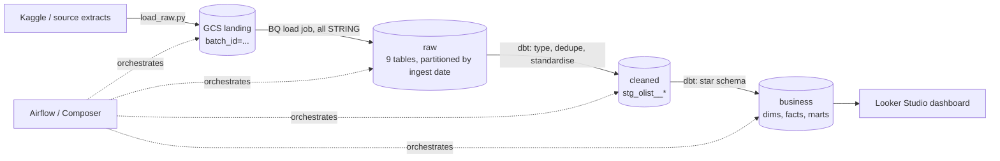

# Olist Marketplace Data Warehouse on BigQuery

End-to-end ELT warehouse for a Brazilian e-commerce marketplace (Olist public dataset), built as a
**raw → cleaned → business** layered model on BigQuery with dbt, orchestrated by Airflow (Cloud Composer)
and provisioned with Terraform.

## Business problem (scenario)

The design assumes a marketplace ops team without a single source of truth for:

1. **Marketplace health** – GMV, AOV, cancellations, new vs returning customers, month over month.
2. **Delivery performance** – which states and sellers miss the delivery promise, and how much that costs in review score.
3. **Seller quality** – which sellers to coach or offboard (late hand-over to carrier, cancellations, low reviews).
4. **CRM targeting** – RFM segments to drive win-back and loyalty campaigns.

Without a warehouse, each team queries raw CSVs with its own definition of "revenue" and "late".
This project gives one governed definition per metric.

## Architecture



| Layer | Dataset | What lives there | Who can read |
|---|---|---|---|
| Raw | `raw` | Exact copy of each extract, every column STRING, plus `_ingested_at`, `_source_file`, `_batch_id`. Append-only, partitioned by ingest day. | Data engineering |
| Cleaned | `cleaned` | One model per source entity: typed, trimmed, latest version per key, Sao Paulo local time converted to UTC, bad geo points removed. | DE + analytics engineering |
| Business | `business` | `dim_customers`, `dim_products`, `dim_sellers`, `dim_date`, `fct_orders`, `fct_order_items` and 4 marts. | Analysts, BI |

## Data volume

Olist public dataset (Sep 2016 – Oct 2018): ~100k orders, ~112k order items, ~103k payments,
~99k reviews, ~33k products, ~3k sellers and ~1M geolocation points across 9 files.
After running, get exact numbers with:

```sql
select table_id, row_count, round(size_bytes/1e6, 1) as mb
from `YOUR_PROJECT.raw.__TABLES__` order by size_bytes desc;
```

## Key design decisions

- **Schema-on-read raw layer.** All columns land as STRING so a malformed value never breaks the load; it becomes a `NULL` in cleaned and fails a dbt test instead. Raw keeps every batch, so any day can be replayed.
- **Idempotent ingestion.** Re-running a `--batch-id` deletes and reloads only that batch inside a transaction, so Airflow retries never duplicate rows.
- **Customer identity.** Olist issues a new `customer_id` per order. The model uses `customer_unique_id` as the real customer key, otherwise repeat-purchase rate is always 0%.
- **Timezones.** Source timestamps are Sao Paulo wall-clock time. They are stored as UTC `TIMESTAMP`, while business dates (`purchase_date`) are computed in local time so "orders on 1 Jan" matches what the business sees.
- **Incremental fact with a look-back.** `fct_orders` is `insert_overwrite` on daily `purchase_date` partitions and re-processes the last 30 days each run, because orders move from *shipped* to *delivered* weeks after purchase. Clustered by `customer_state, order_status`.
- **Data quality gates.** 50+ dbt tests (uniqueness, referential integrity, accepted values, ranges) plus singular reconciliation tests: payments vs items+freight, no orders lost between layers, delivery not before purchase. `dbt build` runs tests between layers, so business tables are never rebuilt from a failing cleaned layer. Failed rows are stored in `dbt_test__audit` for triage.
- **Environments and governance.** Dev and CI build into prefixed datasets (`dev_<user>_business`, `ci_pr42_business`); only prod writes to `business`. Analysts get IAM read on `business` only (Terraform). Dev queries are capped with `maximum_bytes_billed`.

## Business outputs

| Mart | Question it answers |
|---|---|
| `mart_monthly_kpis` | How is the marketplace trending (GMV, AOV, cancellations, new customers, late rate, review score)? |
| `mart_delivery_performance` | Which states are slowest, and how many review points does a late delivery cost? |
| `mart_seller_scorecard` | Which sellers are `at_risk` / `needs_coaching` / `healthy`? |
| `mart_customer_rfm` | Which customers are champions, high-value-new, lapsed big spenders, hibernating? |

Analyses in `dbt/analyses/`: `late_delivery_impact.sql` (review score by days early/late) and `cohort_retention.sql`.

## Run it

Prerequisites: a GCP project with billing or the free BigQuery sandbox, `gcloud`, Python 3.10+, a Kaggle API key (`~/.kaggle/kaggle.json`), Terraform (optional).

```bash
export GCP_PROJECT=your-project-id
gcloud auth application-default login

make setup          # pip install, dbt deps, profiles.yml
make infra          # optional: bucket, raw/cleaned/business datasets, service account
make ingest         # Kaggle -> GCS -> raw  (~2 min)
make build          # dbt build: cleaned + business + all tests
make docs           # lineage graph at http://localhost:8080
```

No Terraform? Create the bucket and dataset once: `gsutil mb -l US gs://$GCP_PROJECT-olist-landing && bq mk --location=US raw`.

## Repo layout

```
ingestion/load_raw.py            Kaggle -> GCS -> raw (idempotent, lineage columns)
dbt/models/cleaned/              stg_olist__* + sources & tests
dbt/models/business/core/        dims and facts (incremental, partitioned, clustered)
dbt/models/business/marts/       KPI, delivery, seller, RFM marts + exposure
dbt/tests/                       reconciliation tests
dbt/macros/                      timezone, dedupe, schema-per-environment macros
orchestration/dags/              Cloud Composer DAG
infra/terraform/                 bucket, datasets per layer, IAM
.github/workflows/ci.yml         lint + dbt build into an isolated PR dataset
```
